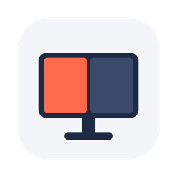

<p align="center">
  
</p>

<h1 align="center">vdisplay</h1>

<p align="center">
  <a href="https://github.com/adamkpn/vdisplay/actions/workflows/security.yml"></a>
  <a href="https://github.com/adamkpn/vdisplay/releases/latest"></a>
  <a href="LICENSE"></a>
</p>

**Run any macOS app on a virtual display of any resolution, and show it in part of your screen.**

vdisplay is a small macOS tool, with a command line and a menu bar app. It creates a virtual monitor (4K, 5K, 8K, ultrawide, or any `WIDTHxHEIGHT`), launches an app on it in native full screen, and shows that monitor live in a window on the left half, a third or a quarter of your real screen. The app believes it is running on a real display of that size, and your other windows stay where they are.

```bash
brew install adamkpn/tap/vdisplay
vdisplay run --view left "Microsoft Edge"
```

That puts Microsoft Edge in native full screen on its own virtual display, shown in the left half of your screen. Move the pointer into it and you are using Edge; move it out and you are back on the rest of your screen.

> **Status:** v0.2, early. Works with Microsoft Edge on macOS 27 (Apple Silicon). Please [open an issue](../../issues) if something misbehaves on your Mac.

## Why

- **Full screen in half a monitor.** Give a browser, IDE or video its own native full screen in half (or a third) of an ultrawide, without fighting a window manager.
- **Big screens on a small one.** Run an app at 5K or 8K on a laptop and see it scaled down, to check responsive layouts or take high-resolution screenshots.
- **A display just for sharing.** Screen-share or record one virtual display at a fixed resolution instead of your whole desktop.
- **Off-screen apps.** Keep an app running on an invisible display, out of the way.

## Features

- **Any resolution:** `WIDTHxHEIGHT` up to 16384x16384, presets (`1080p`, `1440p`, `4k`, `5k`, `6k`, `8k`, `ultrawide`, `superwide`), your screen's `native` resolution, and Retina rendering with `--hidpi`.
- **`--view`:** shows the virtual display live in a window on a half, third or quarter of a real screen. The pointer moves onto the virtual display while it is over the window, so clicks, scrolling and typing go straight to the app.
- **`--mirror`:** makes a whole physical screen mirror the virtual display, scaled to fit. macOS reverts it automatically when vdisplay exits, even after a crash.
- **Window placement:** moves the app's window onto the virtual display and enters native full screen; on exit it takes the window out of full screen and hands it back.
- **`suggest`:** reads your screen's real native resolution and suggests sizes that fit it.
- **Menu bar app:** the same options in a menu and a small Settings window, running in the background and starting at login.
- **One small binary:** universal (Apple Silicon and Intel), no runtime dependencies.

## Install

### Homebrew

Both install the `vdisplay` command and the menu bar app (one binary). Pick one:

```bash
brew install --cask adamkpn/tap/vdisplay   # cask: vdisplay.app in /Applications
brew install adamkpn/tap/vdisplay          # formula: app inside Homebrew's prefix
```

- **Cask:** the app shows up in `/Applications`, Launchpad and Spotlight. vdisplay is not notarized, so if macOS blocks it the first time you open it after an install or upgrade, click **Open Anyway** in *System Settings → Privacy & Security*. `brew uninstall --cask vdisplay` quits the app first, which stops its sessions cleanly; add `--zap` to also remove the settings, logs and the Start at Login agent.
- **Formula:** no Gatekeeper prompt. The app is `$(brew --prefix)/opt/vdisplay/vdisplay.app`: open it from there, or run `vdisplay service install` to start it now and at every login. Quit and reopen it after `brew upgrade`.

Both link `vdisplay` into Homebrew's `bin`, so they can't be installed side by side. To switch, uninstall one first.

### Download

Get the universal binary from the [latest release](../../releases/latest):

```bash
VERSION=0.2.1
curl -LO https://github.com/adamkpn/vdisplay/releases/download/v$VERSION/vdisplay-$VERSION-macos-universal.tar.gz
curl -LO https://github.com/adamkpn/vdisplay/releases/download/v$VERSION/vdisplay-$VERSION-macos-universal.tar.gz.sha256
shasum -a 256 -c vdisplay-$VERSION-macos-universal.tar.gz.sha256
tar -xzf vdisplay-$VERSION-macos-universal.tar.gz
sudo mv vdisplay-$VERSION/vdisplay /usr/local/bin/
```

The binary is not notarized. If you downloaded it with a browser, run `xattr -d com.apple.quarantine vdisplay` first.

The same release has the menu bar app as `vdisplay-$VERSION-macos-app.zip`. Unzip it and move `vdisplay.app` to `/Applications`.

### From source

Needs a Rust toolchain (`brew install rustup && rustup-init`):

```bash
git clone https://github.com/adamkpn/vdisplay && cd vdisplay
make install        # the CLI into ~/.cargo/bin (or: cargo install --path .)
make install-app    # the menu bar app into ~/Applications
```

## Before the first run

These are for the command line. The menu bar app asks for the permissions itself, for vdisplay.app.

1. **Accessibility:** vdisplay moves other apps' windows. Allow your terminal app (Terminal, iTerm2, Ghostty, …) in *System Settings → Privacy & Security → Accessibility* (*Device Control and Data Access* on newer macOS).
2. **Screen Recording** (only for `--view`): allow the same terminal in *System Settings → Privacy & Security → Screen & System Audio Recording*.
3. Restart the terminal after granting either one.
4. Turn on *System Settings → Desktop & Dock → Displays have separate Spaces*, so native full screen stays on the virtual display.
5. **Quit the browser** if you are launching Edge, Chrome or Brave. A running Chromium browser takes over a new launch and the new process exits.

## Usage

### Run an app on a virtual display

```bash
# Edge in native full screen, shown in the left half of your screen
vdisplay run --view left "Microsoft Edge"

# Same, but Edge sees a bigger screen, scaled down into the half
vdisplay run --view left -r 2580x2112 "Microsoft Edge"

# Safari in the right third, on another monitor (IDs from `vdisplay list`)
vdisplay run --view right-third --view-on 2 Safari

# A 5K virtual display mirrored onto your whole main screen
vdisplay run -r 5k --mirror "Microsoft Edge"

# Maximized instead of native full screen; app by bundle id or by path
vdisplay run -r 3440x1440 --no-fullscreen com.microsoft.edgemac
vdisplay run -r 4k /Applications/Figma.app

# Arguments after -- go to the app
vdisplay run -r 4k --new-instance "Google Chrome" -- --user-data-dir=/tmp/chrome-4k
```

The app is found by name, by `.app` path, or by bundle id. vdisplay keeps running until you press Ctrl-C or quit the app; then it takes the window out of full screen, puts it back on your screen and removes the virtual display.

### `--view`: a virtual display in part of your screen

`--view` takes `left`, `right`, `left-third`, `center-third`, `right-third`, `top-left`, `top-right`, `bottom-left` or `bottom-right`. The area stays inside the menu bar and Dock, and `--view-on <ID>` picks another monitor.

Without `-r`, the virtual display is exactly the size of the area, so the window shows it pixel for pixel; on a Retina screen it becomes a Retina display. With `-r`, the picture is scaled to fit the area.

- **Mouse:** when the pointer enters the window, it moves onto the virtual display. Push past the window's side or bottom to come back. The top edge is left alone so the full-screen toolbar can still slide down.
- **Keyboard:** typing goes to the app, as usual. vdisplay never takes keyboard focus.
- **Windows:** the viewer is a normal window; other apps can still cover it.
- **Smoothness:** the virtual display runs at your screen's refresh rate (85 Hz on an 85 Hz monitor), so scrolling doesn't judder, and the pointer is drawn by the viewer rather than captured, so it keeps up with your hand. To check, run with `VDISPLAY_STATS=1`: every 2 seconds it prints the captured frame rate, the capture-to-window delay and the longest pause in vdisplay's loop.

### Menu bar app

`vdisplay.app` puts a display icon in the menu bar (no Dock icon):

- **Run *app*** starts a session with the current settings; **Run Other App** picks a recent one; **Create Display Only** is `vdisplay create`.
- **Running** lists the sessions, each with **Stop** and **Open Log**; the icon shows how many are running.
- **Settings…** has every `run` / `create` option: app (or **Choose…** any `.app`), app arguments, resolution (presets, `native`, the sizes `suggest` lists for the chosen screen, or custom), Retina, refresh rate, where to show it (a part of the screen, mirrored, or not at all), which screen, full screen, new instance, keep alive, name, ppi and window timeout. Changes are saved right away to `~/Library/Application Support/vdisplay/settings.conf`.
- **Displays** is `vdisplay list`; **Permissions** shows and opens the Accessibility and Screen Recording settings.
- **Start at Login** installs a LaunchAgent. From a terminal: `vdisplay service install | uninstall | status`. launchd restarts the app if it crashes, but not after **Quit**.

Each session is a `vdisplay run` / `create` process started by the app, with its output in `~/Library/Logs/vdisplay/`. **Stop** and **Quit** end them the way Ctrl-C does: the window leaves full screen and comes back to your screen, and the display is removed. If a session fails (for example Edge was already running), the app shows the error. If you click **Stop sharing** in the macOS menu bar, the window dims and the app offers **Reconnect** or **Stop Session**.

Permissions go to **vdisplay.app**, not your terminal; the app asks for them on first start. Newer macOS calls the Accessibility pane *Device Control and Data Access*; **Permissions** in the menu opens the right pane either way.

#### Switched on in System Settings, but still no access

macOS ties a permission to the app's code signature. An ad-hoc signed build (`make app` without a certificate, and the current Homebrew releases) is a new identity every time it is rebuilt or upgraded, so the old switch stays on but no longer matches. Click **Reset and Ask Again** in the alert, or **Permissions → Reset Permissions…**, then allow vdisplay once more.

For your own builds, run `make signing-cert` once. It adds a self-signed "vdisplay Local Signing" certificate to your login keychain, and `make app` / `make install-app` then sign with it, so permissions survive rebuilds. The trade-off: codesign may use that key without asking, so other software running as you could sign itself as vdisplay and inherit its access. Only do this on a Mac you trust, and delete the certificate in Keychain Access to undo it. `make install-app SIGN_IDENTITY="Developer ID Application: …"` uses a real certificate instead.

`vdisplay menu` runs the same menu from the bare binary, but then permissions are tied to that binary's path.

### Other commands

```bash
vdisplay create -r 6k --mirror   # just a virtual display, until Ctrl-C; drag windows to it yourself
vdisplay list                    # displays and their IDs
vdisplay suggest                 # native resolution of your screen and sizes that fit it
```

`vdisplay suggest` on a 34" ultrawide:

```
Display 3 (main): 3440x1440 px native, 2.39:1, 34.1" at 109 ppi
Current mode: 3440x1440 points (3440x1440 px) @ 85 Hz
Usable area (no menu bar / Dock): 3440x1409 at 0,31 points

Suggested sizes (same aspect ratio, so --mirror fills the screen):
  -r 3440x1440             3440x1440 px   1:1 with the panel when mirrored
  -r 3440x1440 --hidpi     6880x2880 px   same space, rendered at 2x: sharper text when mirrored
  -r 5160x2160             5160x2160 px   1.5x the space, downscaled when mirrored
  -r 6880x2880             6880x2880 px   2x the space, small UI when mirrored
Presets with this aspect ratio: ultrawide

Part of the screen (1:1 with that part of the panel):
  -r 1720x1440             half     left, right
  -r 1146x1440             third    left-third, center-third, right-third
  -r 1720x720              quarter  top-left, top-right, bottom-left, bottom-right
  --mirror stretches to the whole screen, so these show black bars when mirrored.
  To show a virtual display in that part of the screen: vdisplay run --view left "Microsoft Edge"
```

The native resolution is the display mode macOS marks as native, so a Retina MacBook reports its panel (e.g. 3024x1964), not the scaled "looks like" size.

### Options (`run` and `create`)

| Flag | Default | Meaning |
|---|---|---|
| `-r, --resolution` | `--view` area, else `4k` | `WIDTHxHEIGHT`, a preset (`1080p 1440p 4k 5k 6k 8k ultrawide superwide`), or `native` |
| `--view <AREA>` | off | Show the virtual display in a window on part of a real screen |
| `--view-on <ID>` | main display | Physical display for the `--view` window |
| `-m, --mirror` | off | Mirror the virtual display onto a whole physical screen |
| `--mirror-to <ID>` | main display | Physical display to mirror onto |
| `--hidpi` | off (on for `--view` without `-r` on a Retina screen) | Retina rendering: pixels = 2 × resolution |
| `--refresh` | `--view` screen's rate, else `60` | Refresh rate (Hz) |
| `--ppi` | `109` / `218` | Pixel density used for the reported physical size |
| `--name` | `vdisplay` | Display name in System Settings |
| `--no-fullscreen` | off | `run` only: maximize instead of native full screen |
| `--new-instance` | off | `run` only: launch a new instance even if the app is running |
| `--keep-alive` | off | `run` only: keep the display after the app quits |
| `--window-timeout` | `30` | `run` only: seconds to wait for the app's window |

## How it works

1. **Virtual display:** creates a real (headless) display through CoreGraphics' private `CGVirtualDisplay` API, the mechanism DeskPad and BetterDisplay also use. macOS and every app treat it like a connected monitor with exactly the resolution you asked for.
2. **Launch:** starts the app through `NSWorkspace` to get its process ID.
3. **Place:** uses the Accessibility API to move the app's window onto the virtual display, resize it, and switch it to native full screen.
4. **Show:** `--view` captures the virtual display with ScreenCaptureKit and draws it into a borderless window, moving the pointer between the window and the virtual display. `--mirror` uses an app-scoped CoreGraphics display configuration instead.
5. **Clean up:** on Ctrl-C or when the app quits, the window leaves full screen and comes back to your screen, and the virtual display is removed.

## Things to know

- **Without `--view` or `--mirror`, the virtual display is invisible.** It is an extended desktop next to your screen: useful for screen sharing or for apps you only need running somewhere.
- **Already-running apps:** vdisplay moves the app's front window and ignores launch arguments. Chromium browsers hand a new launch to the running instance; quit them first, or use `--new-instance` with a separate `--user-data-dir`.
- **Resolution limits:** very large sizes (e.g. 8K with `--hidpi`, 15360×8640 px) can exceed what your GPU accepts. `applySettings failed` means try a smaller size or drop `--hidpi`.
- **`create` and full screen:** `create` doesn't know which windows you moved onto the display. Take them out of full screen before pressing Ctrl-C, or macOS moves their full-screen Space to your main screen.
- **Private API:** `CGVirtualDisplay` (the virtual display) and `CGSCurrentCursorSeed` (to notice when the pointer's shape changes; optional) are undocumented and may change in a future macOS release. Everything else is public API.

## Compared with DeskPad and BetterDisplay

[DeskPad](https://github.com/Stengo/DeskPad) and [BetterDisplay](https://github.com/waydabber/BetterDisplay) are apps that create virtual displays you manage by hand. vdisplay is built around one job: start a given app on a display of a given size, put it in full screen there, and show it where you want. From the command line that is easy to script, alias or bind to a key; the menu bar app does the same with a click.

## Requirements

- macOS 12 or newer (12.3+ for `--view`), Apple Silicon or Intel.
- Accessibility permission; Screen Recording permission for `--view`.

## Development

`make` lists every target. The ones you will use most:

```bash
make tools      # once: cargo-audit + the x86_64/arm64 rustup targets
make verify     # rustfmt check, clippy -D warnings, tests, release build (same as CI)
make security   # cargo audit, Trivy, Gitleaks, and a check for home paths / e-mails
make dist       # universal tarball (binary + app, formula) + app zip (cask) + sha256s in target/dist
make app        # target/release/vdisplay.app (install-app: copy to ~/Applications)
make icon       # redraw packaging/AppIcon.icns from packaging/make-icon.swift
make signing-cert  # once: self-signed certificate so permissions survive rebuilds
make notices    # THIRD-PARTY-LICENSES.txt for everything compiled into the binary
make run ARGS="suggest"
```

The Trivy, Gitleaks and actionlint targets run in Docker, so there is nothing else to install.

### Releasing

1. Bump `version` in `Cargo.toml` and commit.
2. Tag and push: `git tag v0.2.0 && git push origin v0.2.0`.

[`release.yml`](.github/workflows/release.yml) checks the tag matches `Cargo.toml`, runs `make verify`, `make dist` and the security scans, publishes the tarball, the app zip and their checksums as a GitHub release, and updates the formula and the cask in [adamkpn/homebrew-tap](https://github.com/adamkpn/homebrew-tap). Running the workflow by hand builds the same files as a downloadable artifact without publishing.

### Project layout

```
src/
├── main.rs      CLI (clap), orchestration, Ctrl-C handling
├── menubar.rs   Menu bar app: status item, menu, actions
├── prefs.rs     Menu bar app: Settings window
├── settings.rs  Menu bar settings file and the run/create arguments they make
├── sessions.rs  Sessions as child processes: spawn, stop, logs, errors
├── service.rs   LaunchAgent install / uninstall / status
├── vdisplay.rs  CGVirtualDisplay creation, display listing, native resolution, mirroring
├── viewer.rs    --view window: ScreenCaptureKit capture, pointer handoff
├── layout.rs    --view geometry: screen areas, fitting, pointer mapping
├── suggest.rs   Size suggestions from a native resolution
├── window.rs    Accessibility: find, move, resize, full-screen windows
├── launch.rs    NSWorkspace app resolution and launch
├── objc.rs      msg! macro (typed objc_msgSend), CFString/pool helpers, run loop
└── ffi.rs       Hand-written bindings (objc, CF, CG, AX, CoreMedia, dispatch)
```

No objc2 or core-foundation crates: the FFI surface is small, and hand-written bindings avoid their API churn.

## Security

The [Security workflow](.github/workflows/security.yml) runs `make security` on every push to `main`, on pull requests, every week, and before each release:

- `cargo audit`: dependency advisories from the RustSec database
- Trivy: dependency CVEs, hardcoded secrets and misconfigurations
- Gitleaks: credentials anywhere in the git history
- a check for home-directory paths and e-mail addresses in tracked files

A release is only published if the scan passes. The badge shows the latest result on `main`: no known issue was found, which is not a promise that none exist. vdisplay makes no network connections.

## License

[MIT](LICENSE). Release downloads and vdisplay.app include `THIRD-PARTY-LICENSES.txt` with the licenses of the Rust standard library and the crates compiled in (all MIT or Apache-2.0); `make notices` generates it.
